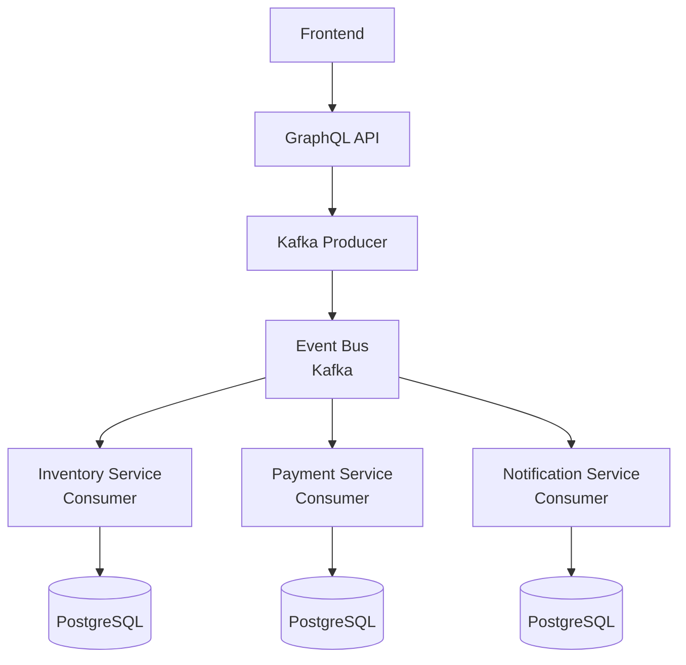

# HOTEL — Event-Driven Microservices Platform

Production-grade hotel operations platform demonstrating event-driven architecture using Kafka.

## Stack

- **Backend:** NestJS + GraphQL
- **Frontend:** React + Vite
- **Database:** PostgreSQL
- **Messaging:** Apache Kafka (event streaming)
- **Orchestration:** Docker Compose

## Event-Driven Architecture

This platform demonstrates:

- **Idempotent consumers** — Duplicate events don't break state
- **Dead-letter queues (DLQs)** — Failed events go to DLQ for replay
- **Distributed state** — Services communicate via Kafka, not REST
- **Event schemas** — Versioned events prevent breaking changes

## Architecture Flow



## Saga Pattern Example

Hotel booking flow uses distributed transactions:

1. `BookingCreated` event → Inventory service reserves room
2. Inventory confirms → `RoomReserved` event → Payment service charges
3. If payment fails → `BookingFailed` event → Inventory releases room (compensation)

## Run Locally

```bash
./start.sh
```

- Frontend: http://localhost:3000
- Backend: http://localhost:8080/graphql

## CI/CD

GitHub Actions runs tests on every push to main.

## Why This Matters for Your Project

This architecture is directly transferable to your order → payment → inventory flow. Replace Kafka with GCP Pub/Sub, and the patterns are identical.
